# Approximating an X rotation with Clifford+T

A fault-tolerant qubit does not come with a continuous family of rotations. On the usual stabilizer codes the gates that can be performed transversally are the Clifford group, and one non-Clifford gate is added to recover universality. That gate is $T$, a $\pi/4$ rotation about $z$ up to a global phase. Every other rotation, including $R_x(\theta)$ for a generic angle, has to be built as a product of $H$, $S$ and $T$.

This note measures that construction on the Bloch sphere. $S$ and $T$ make $z$-rotations by multiples of $\pi/4$ exact. Conjugation by $H$ turns those into $x$-rotations, and nothing else at that cost. The question is how far an arbitrary $R_x(\theta)$ sits from this ladder, and how many $T$ gates it takes before the residual rotation actually shrinks. $T$ is the costly gate: Cliffords are absorbed into the accounting rather than charged. Definitions and the enumeration are in [docs/methods.md](docs/methods.md).

## A pure state is a point

A qubit state is a unit vector in $\mathbb{C}^2$, up to a global phase. The phase-invariant object is the Bloch vector

$$
\mathbf{r}=\bigl(\langle X\rangle,\langle Y\rangle,\langle Z\rangle\bigr),
$$

with $|\mathbf{r}|=1$ precisely when the state is pure. In the usual parametrization,

$$
|\psi\rangle=\cos(\theta/2)\,|0\rangle+e^{i\varphi}\sin(\theta/2)\,|1\rangle,
$$

the coordinates are $\mathbf{r}=(\sin\theta\cos\varphi,\sin\theta\sin\varphi,\cos\theta)$.

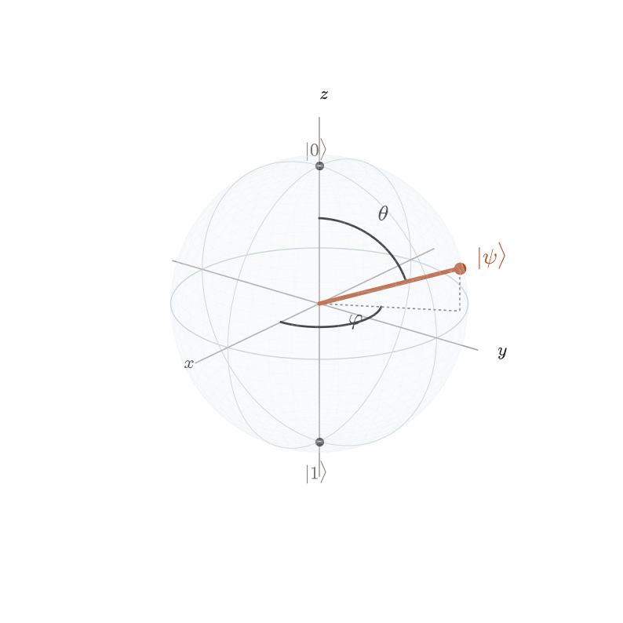

The state drawn here has $\theta=2\pi/5$ and $\varphi=2\pi/3$. The two angles are the only data a pure state carries. Any later plot on this sphere is a plot of those expectations.

## The rotations we would like to have

A unitary on one qubit moves $\mathbf{r}$ by a rotation. The three one-parameter families $R_x$, $R_y$ and $R_z$ are the great circles below. A generic single-qubit gate is some point of $\mathrm{SU}(2)$ off these circles, but the family that has to be synthesized in what follows is the rust circle: $R_x(\theta)$ as $\theta$ runs through a full turn.

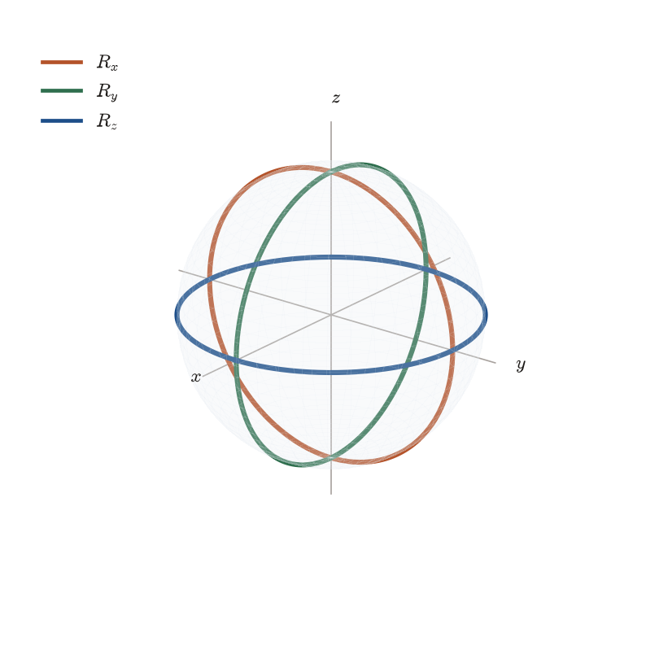

## Three Euler angles, one of them invisible from the ground state

Every single-qubit unitary can be written

$$
U_3(\theta,\varphi,\lambda)=
\begin{pmatrix}
\cos(\theta/2) & -e^{i\lambda}\sin(\theta/2) \\
e^{i\varphi}\sin(\theta/2) & e^{i(\varphi+\lambda)}\cos(\theta/2)
\end{pmatrix}.
$$

On the ground state the third angle drops out,

$$
U_3(\theta,\varphi,\lambda)|0\rangle
=\cos(\theta/2)\,|0\rangle+e^{i\varphi}\sin(\theta/2)\,|1\rangle.
$$

The left panel is that image as $(\theta,\varphi)$ varies: the sphere is covered, and the color is $\varphi$. The right panel holds $(\theta,\varphi)$ fixed at $(2\pi/3,\pi/5)$ and varies $\lambda$. All three expectations stay constant. Preparing a state from $|0\rangle$ is a two-parameter problem.

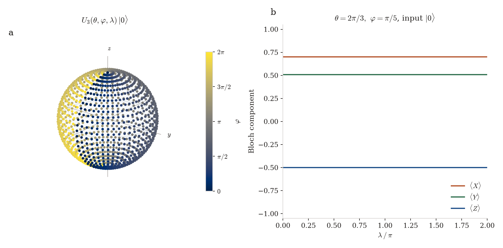

The same angle is visible as soon as the input has support on both basis states. Factoring out a phase,

$$
U_3(\theta,\varphi,\lambda)=e^{i\lambda/2}\,U_3(\theta,\varphi,0)\,R_z(\lambda).
$$

$R_z(\lambda)$ fixes $|0\rangle$ and rotates $|+\rangle$ by $\lambda$. Because the remaining factor does not depend on $\lambda$, the Bloch angle between $U_3(\theta,\varphi,\lambda)|+\rangle$ and $U_3(\theta,\varphi,\lambda+\alpha)|+\rangle$ is exactly $|\alpha|$, for every $(\theta,\varphi)$.

At $\lambda=\pi/2$ that identity puts every sample on the equator: $R_z(\pi/2)|+\rangle$ is $|{+}i\rangle$, and $U_3(\theta,\varphi,0)$ preserves the equal-weight condition, so $\langle Z\rangle=0$ throughout the right panel. At $\lambda=0$ the same $(\theta,\varphi)$ grid does not. The rust point is one matched pair, $(\theta,\varphi)=(2\pi/3,\pi/5)$, moved by a right angle. Implementing the gate, rather than preparing a state from $|0\rangle$, really does use the third angle.

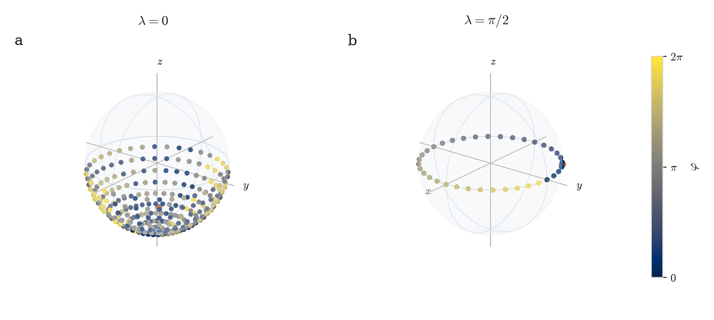

## What is already exact

$H$, $S$ and $T$ sit at known Euler angles,

$$
H=U_3(\pi/2,0,\pi),\qquad S=U_3(0,0,\pi/2),\qquad T=U_3(0,0,\pi/4),
$$

and $T=e^{i\pi/8}R_z(\pi/4)$, $S=T^2$, $Z=S^2$. On the input $|+\rangle$, whose Bloch vector is the $+x$ pole, a $z$-rotation is a motion along the equator and $H$ sends the state to $|0\rangle$. $X$ fixes this particular state, so it is not drawn.

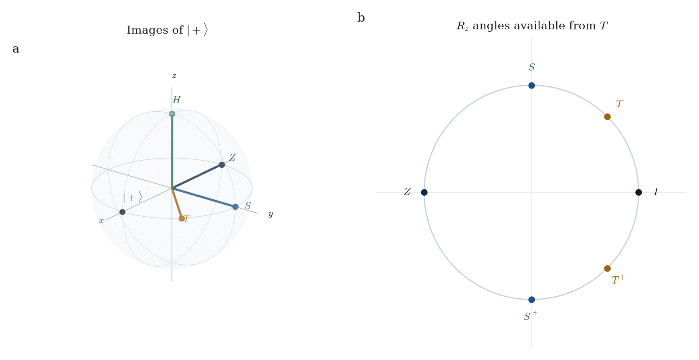

The circle on the right is the whole $z$-rotation group that $T$ generates: angles $k\pi/4$, eight of them, and then it repeats. The gap between neighbors is $\pi/4$.

## Hadamard moves that ladder onto the X axis

Conjugation by the Hadamard exchanges $z$ and $x$ as matrices, not only up to a phase,

$$
H R_z(\theta) H = R_x(\theta).
$$

The left panel is the orbit of $|+\rangle$ under $R_z$. The right panel is the same orbit after $H$, which is the orbit of $|0\rangle$ under $R_x$. Color is the angle $\theta$. The marked point is $\theta=\pi/2$: $|{+}i\rangle$ on the left, the state $R_x(\pi/2)|0\rangle$ on the right.

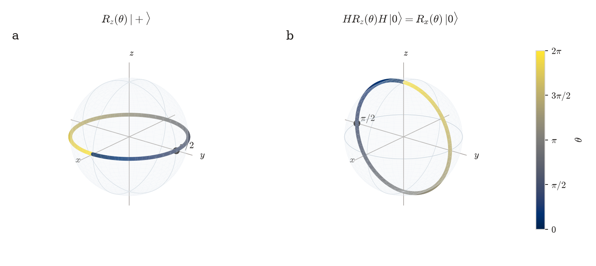

Combined with $T^k=e^{ik\pi/8}R_z(k\pi/4)$, the gates $H T^k H$ are exactly $R_x(k\pi/4)$. Those eight states are the rust points. Between them the continuous family is not hit.

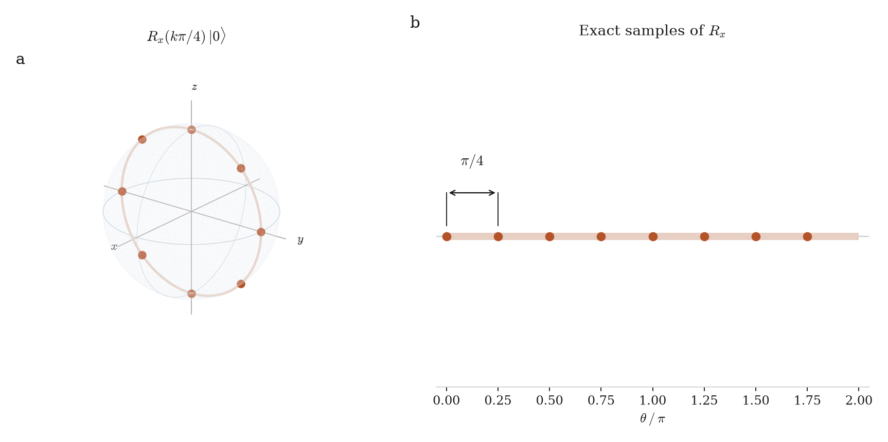

The midpoint of a gap is $\theta=\pi/8$. Its rotation distance to the nearest exact sample is $\pi/8$, which is $22.5^\circ$. That angle is the one tracked through the rest of the note.

## The group is larger than the ladder

Products of $H$, $S$ and $T$ are not confined to those eight rotations. Up to global phase every such gate has a representative

$$
C_0\, T\, C_1\, T\, \cdots\, T\, C_t
$$

with each $C_i$ Clifford and with $t$ minimal. The single-qubit Clifford group, generated by $H$ and $S$, has 24 elements. $T^\dagger$ does not need its own generator: $T^\dagger=S^3 T$. Searching this normal form by increasing $t$ is exhaustive. The set of distinct gates with $T$-count at most $t$ has

$$
72\cdot 2^{t}-48
$$

elements: 24 with no $T$ gate, then 72, 144, 288, and so on, doubling at every further $T$.

The panels below are the orbit of $|+\rangle$, not the group itself. Many gates share an image. $T$-count 0 gives the six Pauli eigenstates. Each added $T$ spreads new points over the sphere: 18 images at $T$-count 1, 42 at $T$-count 2, 186 at $T$-count 4.

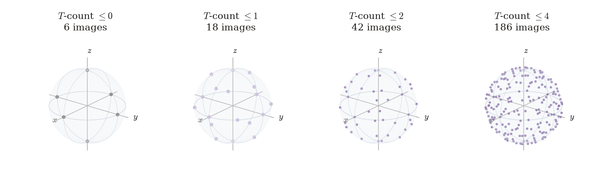

The orbit grows at $T$-count 2. The next section is about whether any of those new gates moves closer to $R_x(\theta)$.

## Distance between two rotations

Global phase is not a physical difference, so the comparison of two gates is the process fidelity

$$
F(U,V)=\frac{1}{4}\left|\mathrm{Tr}(U^{\dagger} V)\right|^{2}.
$$

$F=1$ exactly when $V=e^{i\alpha}U$. Removing that phase, $U^\dagger V$ is a Bloch rotation by some angle $\delta\in[0,\pi]$, and

$$
F=\cos^2(\delta/2),\qquad \delta=2\arccos\sqrt{F}.
$$

$\delta$ is the angle by which the approximation mis-rotates every Bloch vector. It is the quantity on the vertical axes below. For this one-parameter family it has a closed form on the nose whenever the nearest available gate is another $x$-rotation: $\delta(\theta)$ is then the distance from $\theta$ to the nearest available sample.

## Where the error sits, and what it costs

The curves are the minimal $\delta$ for $R_x(\theta)$, read on a grid of spacing $0.25^\circ$. Budgets that do not change the curve are omitted from this plot and stated in the text. The dashed line is $\theta=\pi/8$.

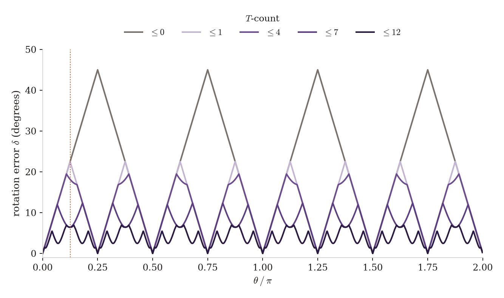

At $T$-count 0 the optimum is exactly the distance from $\theta$ to the nearest multiple of $\pi/2$. The error is a sawtooth of height $45^\circ$, zero on $k\pi/2$, and $22.5^\circ$ at the midpoints $k\pi/4$. One $T$ gate replaces that ladder by the multiples of $\pi/4$. The sawtooth keeps its shape and halves: height $22.5^\circ$, zeros on $k\pi/4$, median $11.25^\circ$. The old worst angles become exact, and the new worst angles are the odd multiples of $\pi/8$.

$T$-count 2 and $T$-count 3 reproduce the $T$-count 1 curve at every sampled $\theta$. The gates added in those two shells are real — the orbit above grows from 18 points to 42 and then to 90 — and none of them is closer to any $R_x(\theta)$ than $H T^k H$ already was. The first budget that beats the $\pi/4$ ladder is $T$-count 4. It lowers the peaks from $22.5^\circ$ to $19.46^\circ$ and leaves the median untouched, still $11.25^\circ$. $T$-count 6 reproduces $T$-count 5 exactly. The median on the circle stays at the ladder value through $T$-count 6 and first drops at $T$-count 7, to $7.49^\circ$.

The same search against 1024 Haar-random targets, seed 0, behaves differently. Away from the $x$-rotation subgroup the median error falls at every increment of $T$-count, including 2 and 3. Those shells are useful for a generic rotation. They are useless for this family.

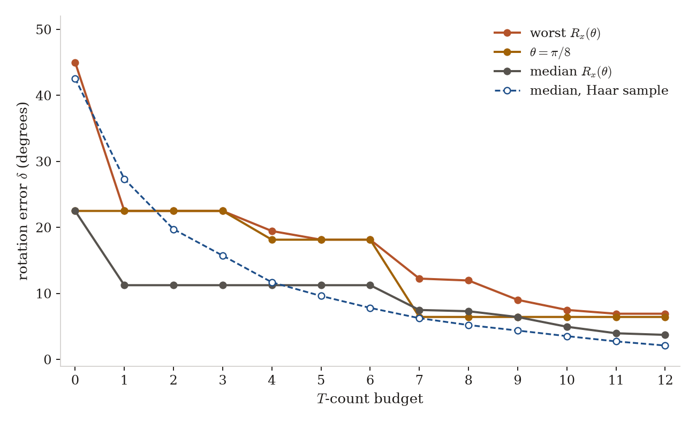

| $T$-count | gates | worst $\delta$ | median $\delta$ | $\delta(\pi/8)$ | Haar median |
| ---: | ---: | ---: | ---: | ---: | ---: |
| 0 | 24 | 45° | 22.5° | 22.5° | 42.58° |
| 1 | 96 | 22.5° | 11.25° | 22.5° | 27.34° |
| 2 | 240 | 22.5° | 11.25° | 22.5° | 19.74° |
| 3 | 528 | 22.5° | 11.25° | 22.5° | 15.73° |
| 4 | 1,104 | 19.46° | 11.25° | 18.15° | 11.69° |
| 5 | 2,256 | 18.15° | 11.25° | 18.15° | 9.62° |
| 6 | 4,560 | 18.15° | 11.25° | 18.15° | 7.81° |
| 7 | 9,168 | 12.25° | 7.49° | 6.44° | 6.25° |
| 8 | 18,384 | 11.96° | 7.31° | 6.44° | 5.21° |
| 9 | 36,816 | 9.03° | 6.43° | 6.44° | 4.38° |
| 10 | 73,680 | 7.50° | 4.96° | 6.44° | 3.53° |
| 11 | 147,408 | 6.93° | 3.97° | 6.44° | 2.74° |
| 12 | 294,864 | 6.93° | 3.72° | 6.44° | 2.11° |

From $T$-count 4 upward the worst-case entries are maxima on the $0.25^\circ$ grid. Moving $\theta$ by $\varepsilon$ moves the target rotation by $\varepsilon$, so the continuous maximum lies within half a step, $0.125^\circ$, of the tabulated one. The entries through $T$-count 3 are exact, not grid artifacts: the optimal error is the distance to the ladder.

## $\pi/8$ is not improved by the gate that creates it

$\theta=\pi/8$ is $22.5^\circ$ from $0$ and $22.5^\circ$ from $\pi/2$, and it is the same distance from $0$ and from $\pi/4$. Raising the $T$-count from 0 to 1, which is exactly the step that makes $R_x(\pi/4)$ available, does not move this state. Nor do $T$-count 2 or 3. The best gate through all four budgets is a Clifford.

$|+\rangle$ is the wrong state to look at: it is the axis of $R_x$, so the identity and $R_x(\pi/8)$ send it to the same point and the $22.5^\circ$ error is invisible. The left panel uses $|0\rangle$ instead. The Clifford approximation, which is the identity, leaves $|0\rangle$ at the north pole, $22.5^\circ$ from $R_x(\pi/8)|0\rangle$. The $T$-count 12 gate moves $|0\rangle$ to within $1.32^\circ$ of the target. That is not the gate error. The residual rotation at that budget is still $\delta=6.44^\circ$; it lies nearly along $z$, so the pole barely feels it and states on the equator still do. The right panel is that gate angle, not the opening between the arrows.

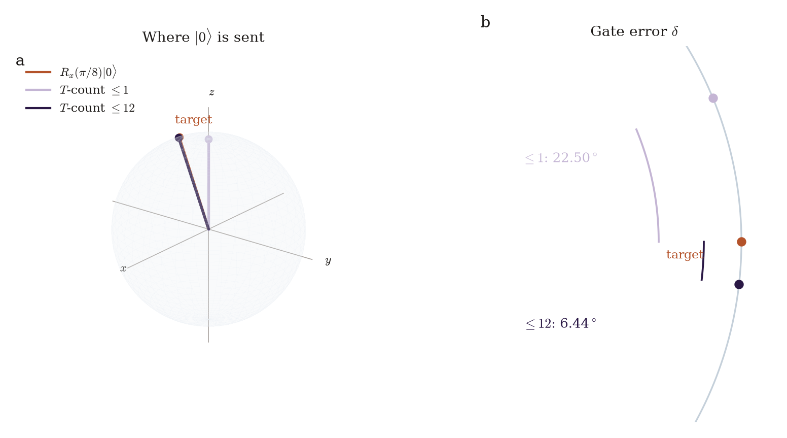

The first improvement is at $T$-count 4, from $22.5^\circ$ to $18.15^\circ$, realized by

```text
H S H T H T H T H T
```

Four $T$ gates. A second drop, at $T$-count 7, reaches $6.44^\circ$,

```text
T H T H S T H T H S T H T H T
```

and that word is still optimal at $T$-count 12. Five further $T$ gates, and a group that has grown from 9,168 elements to 294,864, do not produce a closer gate for this angle. At the top of the budget the worst angle on the circle is $6.93^\circ$ and the median is $3.72^\circ$. The rotations $R_x(k\pi/4)$ have been exact since the first $T$. Everything else, including the midpoint that the $\pi/4$ ladder was built to approach, is still a residual rotation of the Bloch sphere.

The figures and the table are produced by `python -m clifford_t.study`.

## The fixed-angle checks

The enumeration is the exhaustive form of six PennyLane scripts in [labs/](labs/). Each one holds an angle or a named gate fixed and prints a state, a fidelity, or a Bloch vector. `Lab-puertaT.py` checks $R_x(\pi/4)=HTH$. `Lab-Clifford+T.py` compares $R_x(\pi/8)$ with the word $HTS^{\dagger}TH$. `Lab-U3.py` and the two `Lab-U3-HTScomp` scripts are the $U_3$ and named-gate comparisons drawn above. `Lab-norma.py` normalizes a two-qubit state from the same notebook folder. Install them with `pip install -e ".[labs]"`.
